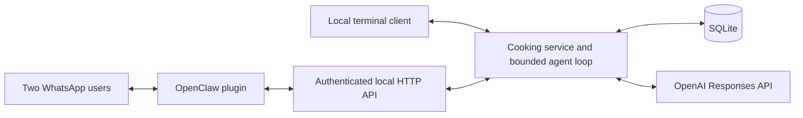

# Architecture and later deployment



## Boundaries

- `store.py`: short SQLite transactions, foreign keys, schema versioning, WAL mode,
  decimal arithmetic for shopping quantities, separate per-person conversation history.
- `tools.py`: bounded schemas used for both model tools and server-side validation;
  caller identity is bound outside model arguments. Recommendations use restrictions,
  separate taste scores/ratings and recent meals. The lower partner score receives
  extra weight before total enthusiasm, to reduce one person's preferences dominating.
- `agent.py`: fixed OpenAI HTTPS endpoint, no model-hosting dependency, no arbitrary
  URL fetches or shell tools, bounded context, at most eight model calls and twenty
  tool calls per turn. Model/provider selection is explicit; no silent paid fallback.
- `server.py`: transport-independent routing and a development-only HTTP adapter.
  Bearer authentication, body limits, loopback binding, request validation, no payload
  access logs. Health is public but reveals no configuration. Local holders of the
  service token have household-wide administrative access.
- `openclaw/`: JavaScript adapter using native command and optional tool registration.
  No runtime npm dependencies. Only channel metadata supplies sender identity.

The app has one household and two fixed internal member IDs. Display names and
WhatsApp mappings are configuration. It is not a multi-tenant service.

## Consistency and failures

Run one service process against one database. A household-level lock serializes agent
turns and structured HTTP tool mutations. SQLite transactions protect concurrent local
tool writes, but separate CLI sessions do not share the in-process agent lock. Avoid
running independent interactive chats and HTTP agent instances concurrently.

The HTTP chat API requires a caller-generated `request_id`. Repeating a completed
request with the same ID, member and text returns its stored reply. Reusing an ID for
different text or a different person fails. Pending/failed requests are not automatically
retried because some earlier tool actions may already have committed. This is request
replay protection, not whole-conversation rollback or exactly-once WhatsApp delivery:
OpenClaw's command context does not supply a documented stable inbound message ID,
so each adapter invocation receives a fresh UUID. A manually repeated command is a
new request. Tool calls are individually atomic; a later model/network failure can
leave earlier changes saved. Duplicate tool-call IDs within a turn are rejected.

Shopping contributions are tracked per selected meal, so repeated builds replace
contributions instead of adding them twice. Manual extras are tracked separately.
No ingredient alias ontology or unit conversion is guessed. Recipe contents are
immutable once saved; save a separate recipe variant when changing ingredients.

Shopping item IDs are monotonic, including after list clearing, to avoid applying
old conversation references to new ingredients. Startup migrates version-1 SQLite
databases to version 2 without changing existing item IDs or contributions. Ranking
uses aggregated ratings across the entire feedback table; the chat-facing history
limit does not expire older preference evidence.

Per-person recent chat context is bounded. Profiles, recipes, selections, feedback and
request replay records persist until the database is removed or a future retention
policy is added. These are private runtime files and must not be committed.

## HTTP API

| Method | Path | Authentication | Purpose |
| --- | --- | --- | --- |
| GET | `/health` | None | Liveness only |
| GET | `/v1/state` | Bearer | Household profiles, recipes, feedback, selections, shopping |
| GET | `/v1/tools` | Bearer | Tool definitions and schemas |
| POST | `/v1/chat` | Bearer | Natural-language turn |
| POST | `/v1/tool` | Bearer | Structured local tool call, no model required |

Local chat body:

```json
{ "source": "local", "member_id": "person-1", "message": "Recommend dishes", "request_id": "unique-id" }
```

WhatsApp body (sent by the trusted plugin only):

```json
{ "source": "whatsapp", "sender_id": "+491234567890", "message": "Recommend dishes", "request_id": "unique-id" }
```

Supplying `member_id` with WhatsApp source is rejected. `/v1/tool` uses the same
identity fields plus `name` and `arguments`. It is an authenticated administrative
interface and does not have chat request replay semantics. Validation errors return
400, missing/invalid tokens 401, unknown WhatsApp senders 403 and a full queue 429.

## Later deployment

Public routability is not required by the WhatsApp linked-device connection. An
always-on private VM/container can run both services and make outbound connections.

Before any public HTTP access:

1. Replace the standard-library development HTTP listener with a production server
   adapter around `Application`, or keep it private behind a trusted hardened proxy.
   Configure TLS, rate limits, header/body limits, request deadlines and network policy.
2. Keep OpenClaw administration and the cooking service private whenever possible.
   Never expose an unauthenticated gateway or reuse a public chatbot token for admin access.
3. Mount persistent storage for the SQLite database/WAL files and OpenClaw sessions.
   Use encrypted private backups, a non-root process and restrictive file permissions.
4. Supply `.env` values through deployment secrets; do not bake credentials or the
   WhatsApp session into images. `.dockerignore` excludes these files if containerized later.
5. Start with one worker process. Multiple workers require shared coordination for
   whole-agent turns and replay handling, not just SQLite file locking.
6. Repeat credentialed smoke tests from both phones, including preferences, feedback,
   cross-chat shopping edits, process restarts, QR recovery and backup restoration.

The model remains hosted by OpenAI after deployment. Gemini support can be added by
implementing the model client's `create(messages, tools)` interface and translating
its tool-call protocol; the domain and storage layers need not change.
